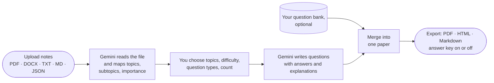

<p align="center">
  
</p>

<p align="center">
  
  
  
  
</p>

Upload your notes or a textbook chapter and get back a ready-to-print exam paper. The app reads
the material, finds the topics worth testing, and writes questions in the types and difficulty
you choose. You can mix in your own question bank, then export with or without an answer key.

## How it works



- **Topic map first.** Before any question is written, the model lists the topics and subtopics
  in your material, each rated High, Medium or Low importance, so the paper covers what matters.
- **You stay in control** of subject, topics, difficulty, question types (MCQ, short answer,
  essay) and the number of questions (1–100).
- **Your own questions count too.** Questions from your bank are mixed in with the generated ones.
- **The answer key is optional:** export the paper with answers and explanations, or without them.
- **It handles quota limits.** Requests fall back to lighter Gemini models automatically, and if the
  quota is exhausted the API returns HTTP 429 so the UI can tell you instead of failing silently.
- **Generation and export requests are validated** with Pydantic.

## Quick start

```bash
git clone https://github.com/NamanSingh69/Question-Paper-Generator.git
cd Question-Paper-Generator
python -m venv .venv && source .venv/bin/activate   # Windows: .venv\Scripts\activate
pip install -r requirements.txt

export GEMINI_API_KEY=...        # https://aistudio.google.com/apikey
export PYTHONUTF8=1              # Windows consoles: the app logs emoji
python app.py
```

Open <http://localhost:5000>, upload a file of at least 100 words, and follow the steps.

The **HTML → PDF** endpoint uses `pdfkit`, which needs [wkhtmltopdf](https://wkhtmltopdf.org/)
installed. The standard PDF export does not need it.

## Tests

End-to-end browser tests (Playwright) cover upload validation, the step-by-step flow and
44 px touch targets on mobile:

```bash
npx playwright test tests/
```

## API

| Method | Path | What it does |
|---|---|---|
| `POST` | `/api/upload` | Uploads a file and returns the topic analysis |
| `POST` | `/api/generate-questions` | Generates questions from the analysed file and your settings |
| `POST` | `/api/export` | Returns the paper as `pdf`, `html` or `md`, with an optional answer key |
| `POST` | `/api/convert-html-to-pdf` | Converts an edited HTML paper to PDF (needs wkhtmltopdf) |
| `GET` | `/api/models` | Lists the Gemini models your key can use |
| `GET` | `/api/health` | Health check |

## Project layout

```
app.py                    Flask app: upload, topic analysis, generation, export
schemas.py                Pydantic request models
gemini_model_resolver.py  discovers available Gemini models and ranks the fallbacks
static/                   single-page UI (index.html, js/main.js)
tests/                    pytest API tests and Playwright end-to-end tests
api/index.py, vercel.json Vercel serverless deploy
```
